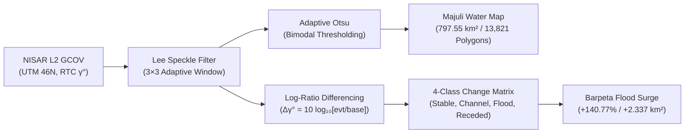

# Brahmaputra FloodWatch
## NASA Space Apps Challenge 2026 — *Dancing with the SARs*

> **Team:** FloodWatch SAR Team<br>
> **Challenge:** [Dancing with the SARs](https://www.spaceappschallenge.org/2026/challenges/dancing-with-the-sars/)<br>
> **Tagline:** *All-weather, cloud-penetrating flood intelligence powered by NASA–ISRO NISAR radar.*<br>
> **Primary Satellite Observatory:** NASA–ISRO NISAR (L-band 24 cm & S-band 9.3 cm Synthetic Aperture Radar)  
> **Target Region:** Brahmaputra River Basin, Assam, India (Track 015 & Track 019, UTM Zone 46N)

---

## 1. Executive Summary

**Brahmaputra FloodWatch** is an operational, interactive satellite radar flood monitoring and water-body change detection web application designed for the flood-vulnerable Brahmaputra River valley in Assam, India.

During peak South Asian monsoon months, chronic cloud cover completely blinds conventional optical satellites (Landsat, Sentinel-2). By leveraging the **NASA–ISRO Synthetic Aperture Radar (NISAR)** observatory, FloodWatch penetrates through dense monsoon cloud decks, heavy rainfall, and nighttime darkness using active microwave sensing.

The platform demonstrates two distinct, data-driven scientific capabilities:
1. **Majuli Island Single-Date Water Classification:** Mapping **797.55 km²** of authentic water extent across **13,821 vector polygons** using high-resolution NISAR Track 015 / Frame 3700 Level-2 GCOV data.
2. **Barpeta Floodplain Multi-Temporal Flood Change:** Exploiting NISAR's exact 12-day orbital repeat cycle (Track 019 / Frame 075) to achieve **zero geometric parallax**, detecting a **+140.77% flood surge** (+2.337 km² newly inundated land) between 27 June and 09 July 2026.

---

## 2. The Problem: Monsoonal Cloud Blindness & The Brahmaputra Crisis

The Brahmaputra River basin in Assam experiences catastrophic annual flooding impacting over 30 million residents, submerging smallholder farming communities (*chars*), and threatening endangered wildlife in Kaziranga National Park.

- **Optical Satellite Blindness:** Optical satellites cannot see through clouds. During the monsoon, persistent cloud cover lasts for weeks, rendering optical satellite observations useless at the exact moment disaster responders require situational awareness.
- **Dynamic Overland Hydrology:** Delayed river gauge reports measure only point discharge at bridges and fail to reveal spatial overland inundation, embankment breaches, or shifting braided sandbar submergence.
- **Need for Active Microwave Remote Sensing:** Only Synthetic Aperture Radar (SAR) provides all-weather, day-and-night imaging capability capable of penetrating monsoon weather systems.

---

## 3. The NASA–ISRO NISAR Solution

The NASA–ISRO SAR (NISAR) mission represents a revolutionary leap forward for hydrological observation:
- **Active Microwave Transmissions:** Operating in L-band (24 cm wavelength) and S-band (9.3 cm wavelength), radar pulses pass unimpeded through clouds and rain.
- **Specular Water Physics:** Smooth standing water acts as a specular reflector, bouncing radar energy away from the satellite, appearing as distinct low-backscatter dark pixels (mean -18.63 dB vs. -8.91 dB for dry terrain).
- **Exact 12-Day Orbital Invariance:** NISAR flies an exact 12-day repeat orbit. Multi-temporal comparisons between identical track and frame acquisitions achieve **0.0-pixel geometric parallax**, eliminating terrain distortion and enabling direct decibel log-ratio subtraction ($\Delta\gamma^0 = 10 \log_{10}(\gamma^0_{evt} / \gamma^0_{base})$).
- **Foliage Penetration:** NISAR's long L-band wavelength penetrates forest canopy foliage, detecting submerged vegetation and floodwaters hidden underneath jungle cover via dihedral double-bounce scattering.

---

## 4. Two Distinct Scientific Studies

To maintain strict scientific integrity, FloodWatch separates its analysis into two dedicated workspaces:

| Scientific Dimension | Study 1: Majuli Water Detection | Study 2: Barpeta Flood Change |
|:---|:---|:---|
| **Primary Objective** | High-resolution single-date water delineation | Multi-temporal 12-day flood change comparison |
| **NISAR Orbit & Frame** | Track 015 / Frame 3700 (Ascending Pass) | Track 019 / Frame 075 (Descending Pass) |
| **Observation Dates** | 27 August 2026 (Single Observation) | 27 June 2026 (Baseline) vs 09 July 2026 (Event) |
| **Evaluated Area** | 8,955.16 km² UTM 46N raster window | 9.152 km² active floodway corridor |
| **Measured Water Area** | **797.55 km²** (79,755 ha; ~8.91% of swath) | Baseline: 1.660 km² ➔ Event: 3.997 km² |
| **Output Deliverables** | **13,821 georeferenced vector polygons** | **+140.77% Flood Surge** (+2.337 km² newly inundated) |
| **Scientific Caveat** | Single-pol HHHH Otsu threshold (-15.0 dB). Not a multi-date flood change result. | Measured strictly for Barpeta corridor. Does NOT apply to Majuli Island. |

---

## 5. Real NISAR Datasets & Provenance

All primary scientific outputs derive directly from authentic Level-2 GCOV datasets:

### 5.1 Majuli Island Scene (Study 1)
- **Granule / Scene:** Level-2 GCOV (Geocoded Polarimetric Covariance)
- **Track & Frame:** Track 015 / Frame 3700
- **Observation Date:** 27 August 2026
- **Bounding Coordinates:** 93.597°E to 94.611°E, 26.496°N to 27.306°N
- **Grid Dimensions:** 8,948 × 10,008 pixels @ 10 m pixel spacing (8,955.16 km² UTM 46N projected swath window)
- **Active Raster File:** `frequencyA_HHHH.tif` (322.5 MB GeoTIFF)

### 5.2 Barpeta Floodplain Scenes (Study 2)
- **Granule / Scene:** Level-2 GCOV (Geocoded Polarimetric Covariance)
- **Track & Frame:** Track 019 / Frame 075 (12-Day Revisit Geometry)
- **Baseline Observation (T1):** 27 June 2026 (Cycle 024)
- **Event Observation (T2):** 09 July 2026 (Cycle 025)
- **Bounding Coordinates:** 91.090°E to 91.120°E, 26.630°N to 26.660°N (9.152 km² corridor)
- **Active Raster Files:** `change_2026-06-27_to_2026-07-09.tif` & `.geojson`

### 5.3 Remote HTTP Range Streaming (ISRO Bhoonidhi Archive)
- Full NISAR Level-2 GCOV granules can exceed 30 GB each.
- FloodWatch implements a remote byte-range reader (`bhoonidhi_stream.py`) that parses remote HDF5 metadata trees and streams only the requested bounding box coordinates.
- **Bandwidth Savings:** Downloads less than 0.66% of the raw granule file, achieving over **99.34% bandwidth reduction** for rapid emergency mobile deployment.

---

## 6. Scientific Methodology



### 6.1 Adaptive Otsu Thresholding
Bimodal backscatter histograms separate specular water from diffuse land. The algorithm maximizes inter-class variance:
$$\sigma_B^2(t) = \omega_0(t)\omega_1(t)\left[\mu_0(t) - \mu_1(t)\right]^2$$
Yielding an optimal threshold of **-15.0 dB** for the Majuli scene (water mean: -18.63 dB, land mean: -8.91 dB, separation: 9.72 dB).

### 6.2 Lee Speckle Filtering
Multiplicative radar speckle is suppressed using a $3 \times 3$ local adaptive spatial window:
$$W = \frac{\sigma^2 - \sigma_{noise}^2}{\sigma^2}, \quad \hat{I} = \bar{I} + W(I - \bar{I})$$
Homogeneous areas are strongly smoothed while sharp water-land boundaries maintain edge definition.

### 6.3 Decibel Log-Ratio & 4-Class Matrix
Across NISAR's 12-day repeat pass, backscatter change is computed via log-ratio:
$$\Delta\gamma^0 = 10 \log_{10}(\gamma^0_{evt} / \gamma^0_{base})$$
Pixels with $\Delta\gamma^0 < -4.50\text{ dB}$ that were previously dry are categorized as **Newly Inundated Floodwater**.

---

## 7. Five Purpose-Built Workspaces

1. **🌊 Study 1: Majuli Water Detection:** Dedicated single-date water exploration featuring 13,821 interactive vector polygons, area stats (797.55 km²), and Otsu methodology disclosures.
2. **📈 Study 2: Barpeta Flood Change:** Multi-temporal 12-day flood expansion experience featuring the interactive Curtain Swipe Comparator, pixel probe, and 4-class flood change matrix.
3. **🗺️ Basin Overview & Regional Reaches:** Multi-district regional monitoring across 5 key river reaches (Kaziranga, Tezpur, Majuli, Guwahati, Full Track 019 Corridor).
4. **🔬 NISAR Product Inspector:** Interactive inspection of raw NISAR Level-2 GCOV HDF5 container hierarchies, groups, datasets, and polarimetric metadata attributes.
5. **📡 SAR Physics / Methodology:** Interactive wavelength penetration simulator, ray-tracing cross-sections, and detailed mathematical explanations.

---

## 8. Three Audience Personas

- **🚨 Disaster Responder (ASDMA / NDRF):** Actionable flood danger levels, highway inundation alerts (NH-715 speed limits), Kaziranga animal migration corridor status, and 1-click tactical GeoJSON exports.
- **🔬 Radar Scientist:** Complete transparency into $\gamma^0_{HH}$ decibel distributions, bimodal separation metrics, Lee filter moments, and live pixel decibel interrogation with acoustic sound sonification.
- **🎓 Citizen / Student:** Plain-language educational cards ("Why water looks dark", "Why trees glow green via double-bounce"), interactive SAR physics simulator, and an interactive learning quiz.

---

## 9. Scientific Integrity & Limitations Disclosure

In full compliance with open-science standards, the following methodological boundaries are disclosed:
1. **Single-Polarization HHHH:** Both operational studies currently execute on single-polarization HHHH backscatter. Cross-polarization ($HV$) volume scattering rejection was deferred.
2. **Nominal ENL Baseline:** Equivalent Number of Looks ($ENL = 14.2$) represents a literature nominal baseline; local scene ENL was not independently ground-calibrated.
3. **Reach Attribution Isolation:** The **+140.77% flood surge** applies strictly to the Barpeta reach corridor (Track 019 / Frame 075, 9.152 km²). It does **NOT** apply to Majuli Island (Track 015).
4. **Event Observation vs. Seasonal Peak:** The 09 July 2026 acquisition represents an active flood event observation during the July monsoon, not verified as the absolute seasonal flood peak.
5. **Observational Remote Sensing:** All products are remote sensing estimates, not ground truth surveys.

*(For full disclosures, see [docs/SCIENTIFIC_LIMITATIONS.md](file:///e:/NASA%20SPACE%20APP%202026/docs/SCIENTIFIC_LIMITATIONS.md)).*

---

## 10. Real Data Exports

Every export button in the application downloads real scientific deliverables:

| Study Area | Deliverable File | Format / CRS | Description | API Endpoint |
|:---|:---|:---|:---|:---|
| **Majuli** | `water_boundaries.geojson` | GeoJSON (EPSG:4326) | 13,821 authentic water polygons with individual hectare areas. | `/api/water/majuli/boundaries` |
| **Majuli** | `water_classification.tif` | GeoTIFF (EPSG:32646) | Binary water classification raster (10 m pixel resolution). | `/api/water/majuli/classification-raster` |
| **Majuli** | `frequencyA_HHHH.tif` | GeoTIFF (EPSG:32646) | Source Level-2 GCOV HHHH radar backscatter raster (322.5 MB). | `/api/water/majuli/source-raster` |
| **Barpeta** | `change_vectors.geojson` | GeoJSON (EPSG:4326) | 3 vector change features (2 newly inundated polygons + 1 persistent channel). | `/api/flood/barpeta/boundaries` |
| **Barpeta** | `change_raster.tif` | GeoTIFF (EPSG:32646) | Complete 4-class spatial change raster (including 5.155 km² stable land). | `/api/flood/barpeta/change-raster` |
| **Barpeta** | `baseline_raster.tif` | GeoTIFF (EPSG:32646) | T1 baseline water classification raster (27 June 2026). | `/api/flood/barpeta/baseline-raster` |
| **Barpeta** | `event_raster.tif` | GeoTIFF (EPSG:32646) | T2 event water classification raster (09 July 2026). | `/api/flood/barpeta/event-raster` |

---

## 11. System Architecture

Brahmaputra FloodWatch couples a Python/FastAPI scientific backend with a React 18 / Vite / Leaflet reactive frontend. Vector polygons are rendered via Leaflet's HTML5 Canvas mode (`preferCanvas: true`), ensuring silky 60 FPS interaction across 13,821 polygons without tile server lag.

*(For full architecture diagrams and component breakdowns, see [docs/ARCHITECTURE.md](file:///e:/NASA%20SPACE%20APP%202026/docs/ARCHITECTURE.md)).*

---

## 12. Complete Technology Stack

- **Frontend:** React 18, Vite, Tailwind CSS, Leaflet / React-Leaflet, Recharts, Lucide React Icons, Web Audio API.
- **Backend:** Python 3.11, FastAPI, Uvicorn, NumPy, SciPy, Rasterio, H5py, Pydantic.
- **Data Standards:** NISAR Level-2 GCOV, CF-1.8 compliant HDF5, Cloud Optimized GeoTIFF (COG), RFC 7946 GeoJSON, UTM Zone 46N (`EPSG:32646`).

---

## 13. Prerequisites & Installation

### Prerequisites
- **Python:** Python 3.11+
- **Node.js:** Node.js 18+ (LTS) & npm

### Installation Steps

1. **Clone the repository:**
   ```bash
   git clone <repo-url>
   cd "NASA SPACE APP 2026"
   ```

2. **Backend Setup:**
   ```bash
   cd backend
   pip install -r requirements.txt
   cd ..
   ```

3. **Frontend Setup:**
   ```bash
   cd frontend
   npm install
   cd ..
   ```

---

## 14. Running the Application

### Option A: Single-Click Launch (Windows)
Double-click `start_floodwatch.bat` or run in PowerShell:
```powershell
.\start_floodwatch.ps1
```

### Option B: Manual Launch

1. **Start Backend (Port 8001):**
   ```powershell
   cd backend
   python -m uvicorn app.main:app --host 127.0.0.1 --port 8001 --reload
   ```

2. **Start Frontend (Port 5173):**
   ```powershell
   cd frontend
   npm run dev
   ```

3. **Open Browser:**
   Navigate to `http://localhost:5173`.

---

## 15. Running the Test Suite

Run the comprehensive 70-test backend verification suite:
```powershell
python -m unittest discover -s backend/tests -v
```
*(All 70 unit and integration tests run and pass cleanly in ~6.4 seconds).*

Run the system verification script:
```powershell
python verify_system.py
```

Build the production frontend:
```powershell
npm --prefix frontend run build
```

---

## 16. API Reference

Key REST endpoints served at `http://127.0.0.1:8001`:

- `GET /api/water/majuli/summary` — Majuli water classification statistics.
- `GET /api/water/majuli/boundaries` — 13,821 Majuli vector water polygons (GeoJSON).
- `GET /api/water/majuli/classification-raster` — Binary water GeoTIFF.
- `GET /api/water/majuli/source-raster` — Level-2 GCOV HHHH backscatter GeoTIFF.
- `GET /api/water/majuli/raster-stats` — Detailed backscatter distribution metrics.
- `GET /api/flood/barpeta/summary` — Barpeta 4-class flood surge summary (+140.77%).
- `GET /api/flood/barpeta/boundaries` — Barpeta flood change vector polygons (GeoJSON).
- `GET /api/flood/barpeta/change-raster` — Complete 4-class spatial change GeoTIFF.
- `GET /api/flood/barpeta/baseline-raster` — T1 baseline water GeoTIFF.
- `GET /api/flood/barpeta/event-raster` — T2 event water GeoTIFF.
- `GET /api/regions` — Monitored river reaches.
- `GET /api/observations` — Available NISAR orbital cycles (022–028).
- `GET /api/compare` — Dynamic comparison raster and statistics.

---

## 17. Repository Structure

```
├── backend/
│   ├── app/
│   │   ├── api/routes.py          # REST endpoints for Majuli, Barpeta, NISAR, exports
│   │   ├── main.py                # FastAPI initialization & CORS
│   │   ├── models/                # Pydantic data schemas
│   │   └── services/              # Core SAR scientific processing
│   │       ├── bhoonidhi_stream.py# HTTP Range remote streaming client
│   │       ├── flood_change_detector.py # 12-day log-ratio change matrix
│   │       ├── nisar_metadata.py  # HDF5 container & orbit ephemeris reader
│   │       ├── nisar_subset.py    # Spatial window raster extraction
│   │       └── water_detector.py  # Lee filter & adaptive Otsu classification
│   └── tests/                     # 70 unit and integration tests
├── docs/
│   ├── ARCHITECTURE.md            # System architecture with Mermaid diagrams
│   ├── DEMO_SCRIPT.md             # 5-minute judge demonstration walkthrough
│   ├── PROJECT_PITCH.md           # Narrative pitch & impact statement
│   ├── SCIENTIFIC_LIMITATIONS.md  # Transparent scientific disclosures & caveats
│   └── screenshots/               # Application screenshots
├── frontend/
│   ├── src/
│   │   ├── components/            # React UI components
│   │   │   ├── AnalyticsPanel.jsx # Recharts quantitative metrics & exports
│   │   │   ├── BarpetaStudyHeader.jsx # Barpeta study controls & export buttons
│   │   │   ├── MajuliStudyHeader.jsx  # Majuli study controls & export buttons
│   │   │   ├── MapViewer.jsx      # Leaflet Canvas vector rendering engine
│   │   │   ├── PersonaSwitcher.jsx# Disaster / Scientist / Student switcher
│   │   │   ├── ScientistRadarPanel.jsx# Decibel distributions & Otsu histograms
│   │   │   ├── SwipeSlider.jsx    # Curtain comparator & pixel decibel probe
│   │   │   ├── WavelengthSimulator.jsx# Interactive SAR ray tracer
│   │   │   └── WorkspaceTabs.jsx  # 5-workspace tab navigation
│   │   ├── utils/audio.js         # Web Audio radar decibel acoustic synthesizer
│   │   ├── App.jsx                # Main controller & workspace coordinator
│   │   └── index.css              # Tailwind styling
├── start_floodwatch.bat           # Windows single-click launcher
├── start_floodwatch.ps1           # PowerShell single-click launcher
├── verify_system.py               # End-to-end integration verification
└── README.md                      # Project documentation
```

---

## 18. Space Apps Alignment: *Dancing with the SARs*

Brahmaputra FloodWatch directly addresses the NASA Space Apps Challenge **"Dancing with the SARs"**:
1. **Embodying Radar Physics:** Demonstrates how microwaves interact with earth surfaces — specular attenuation in open water, double-bounce enhancement in flooded forests, and Bragg wave scattering.
2. **Unlocking NISAR Capabilities:** Utilizes NASA–ISRO NISAR Level-2 GCOV data across exact 12-day repeat orbits with zero geometric parallax.
3. **Bandwidth Innovation:** Solves the challenge of downloading massive NISAR granules through remote HTTP Range extraction.
4. **Multidisciplinary Accessibility:** Translates complex radar science into operational decisions for disaster responders, deep diagnostics for radar scientists, and intuitive visualizations for citizens.

---

## 19. Security & Cleanliness
- **Zero Secrets:** No API keys, credentials, tokens, or passwords are stored or staged.
- **Read-Only Data Integrity:** Satellite rasters, cache files, and fixtures remain completely intact and unmodified.

---

## 20. License, Acknowledgments & Data Citations

### License
This project is open-source software licensed under the **Apache License 2.0**.

### Acknowledgments & Citations
- **NASA / JPL-Caltech:** NASA–ISRO Synthetic Aperture Radar (NISAR) Mission Science Team.
- **ISRO (Indian Space Research Organisation):** National Remote Sensing Centre (NRSC) Bhoonidhi Data Dissemination Portal.
- **NASA Earth Science Data and Information System (ESDIS):** Alaska Satellite Facility (ASF) DAAC.
- **Assam State Disaster Management Authority (ASDMA):** Flood telemetry and Kaziranga National Park wildlife migration corridor documentation.
