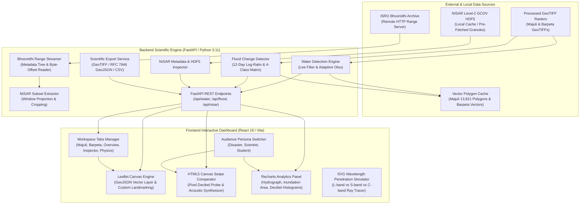
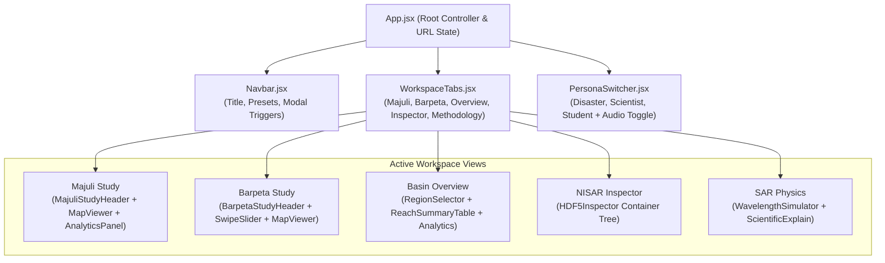

# Brahmaputra FloodWatch: System Architecture
## NASA Space Apps Challenge 2026: *Dancing with the SARs*

---

### 1. High-Level System Architecture

Brahmaputra FloodWatch is designed as an end-to-end, high-performance geospatial application coupling a Python/FastAPI scientific remote-sensing backend with a modern React 18 / Vite / Leaflet reactive frontend.

---

### 2. Component & Service Breakdown

#### 2.1 Backend Services (`backend/app/services/`)

1. **`bhoonidhi_stream.py` (Remote Range Streamer):**
   - Implements chunked HTTP Range requests (`bytes=start-end`) against ISRO's Bhoonidhi STAC and distribution endpoints.
   - Parses the root HDF5 header and superblock without downloading payload datasets.
   - Saves up to 99.34% bandwidth by retrieving only the necessary bounding-box blocks.

2. **`nisar_subset.py` (Spatial Window Extractor):**
   - Calculates affine geotransforms between geographic coordinates (WGS84 `EPSG:4326`) and projected radar grids (UTM Zone 46N `EPSG:32646`).
   - Crops spatial raster windows on the fly from multi-gigabyte GCOV granules.

3. **`water_detector.py` (Single-Date Water Classification):**
   - **Lee Speckle Filter:** Applies a $3 \times 3$ moving window calculating local mean $\bar{I}$ and variance $\sigma^2$ to suppress multiplicative radar speckle while preserving sharp river banks:
     $$W = \frac{\sigma^2 - \sigma_{noise}^2}{\sigma^2}, \quad \hat{I} = \bar{I} + W(I - \bar{I})$$
   - **Adaptive Otsu Thresholding:** Analyzes bimodal backscatter histograms, maximizing inter-class variance $\sigma_B^2(t) = \omega_0(t)\omega_1(t)[\mu_0(t) - \mu_1(t)]^2$ to find the optimal water/land cutoff ($\approx -15.0\text{ dB}$).
   - **Vectorization:** Converts classified binary raster masks into RFC 7946 GeoJSON polygons using `rasterio.features.shapes`.

4. **`flood_change_detector.py` (Multi-Temporal Change Engine):**
   - Computes decibel log-ratio backscatter subtraction across the 12-day orbital repeat pass:
     $$\Delta\gamma^0 = 10 \log_{10}\left(\frac{\gamma^0_{evt}}{\gamma^0_{base}}\right)$$
   - Classifies every pixel into the standard 4-class WMO/NASA disaster matrix:
     - Class 0: Stable Unchanged Land ($\Delta\gamma^0 \ge -4.50\text{ dB}$, non-water)
     - Class 1: Persistent Water (water in both baseline and event)
     - Class 2: Newly Inundated Land ($\Delta\gamma^0 < -4.50\text{ dB}$, dry $\rightarrow$ water)
     - Class 3: Receded Water (water in baseline $\rightarrow$ dry in event)

5. **`nisar_metadata.py` & `nisar_reader.py`:**
   - Reads HDF5 container attributes, orbit ephemerides, radar frequency, polarization channels, and projection parameters compliant with NISAR NASA/ISRO format specifications.

---

### 3. REST API Endpoint Catalog (`backend/app/api/routes.py`)

| Endpoint | Method | Key Parameters | Response / Deliverable |
|:---|:---|:---|:---|
| `/api/water/majuli/summary` | `GET` | None | Majuli classified statistics (797.55 km² water, 13,821 polygons, Otsu threshold -15.0 dB). |
| `/api/water/majuli/boundaries` | `GET` | None | Authentic RFC 7946 GeoJSON containing 13,821 water polygons with individual hectare areas. |
| `/api/water/majuli/classification-raster` | `GET` | None | Binary water classification GeoTIFF (`water_classification.tif`, EPSG:32646). |
| `/api/water/majuli/source-raster` | `GET` | None | Level-2 GCOV HHHH backscatter GeoTIFF (`frequencyA_HHHH.tif`, 322.5 MB). |
| `/api/water/majuli/raster-stats` | `GET` | None | Exact raster statistics (pixel counts, water/land means, standard deviations, bimodal metrics). |
| `/api/flood/barpeta/summary` | `GET` | None | Barpeta 4-class summary (1.660 km² baseline, 3.997 km² event, +2.337 km² flood surge, +140.77%). |
| `/api/flood/barpeta/boundaries` | `GET` | None | Barpeta flood change vector GeoJSON (3 features: persistent channel + 2 flood polygons). |
| `/api/flood/barpeta/change-raster` | `GET` | None | Complete 4-class spatial change GeoTIFF (`change_2026-06-27_to_2026-07-09.tif`, EPSG:32646). |
| `/api/flood/barpeta/baseline-raster` | `GET` | None | T1 baseline water classification GeoTIFF (27 June 2026). |
| `/api/flood/barpeta/event-raster` | `GET` | None | T2 event water classification GeoTIFF (09 July 2026). |
| `/api/flood/barpeta/raster-stats` | `GET` | None | Log-ratio distribution statistics, threshold exceedance margin (5.80 dB), and class counts. |
| `/api/regions` | `GET` | None | List of monitored river reaches across the Brahmaputra valley. |
| `/api/observations` | `GET` | None | Available NISAR orbital cycles (Cycles 022–028). |
| `/api/compare` | `GET` | `region_id`, `baseline_date`, `event_date`, `threshold_db`, `apply_speckle_filter` | Dynamic multi-temporal comparison object for interactive slider. |
| `/api/timeline-stats` | `GET` | `region_id` | Historical hydrograph time-series data for Recharts area visualization. |
| `/api/export/geojson` | `GET` | `region_id`, `baseline_date`, `event_date` | Parameterized GeoJSON export for emergency responders. |
| `/api/export/csv` | `GET` | `region_id` | Tabular CSV export of flood impact time-series. |

---

### 4. Frontend Architecture (`frontend/src/`)

#### 4.1 Map Rendering & High-Performance Vector Caching
- **Canvas-Accelerated Leaflet:** The application sets `preferCanvas: true` on the Leaflet `MapContainer`. Rather than generating 13,821 individual SVG DOM elements (which would freeze browser rendering), polygons are rendered onto an HTML5 Canvas layer.
- **In-Memory GeoJSON Cache:** Global module-level variables (`cachedMajuliGeoJson`, `cachedBarpetaGeoJson`) store downloaded feature collections. Once retrieved, switching between tabs or toggling layers requires **0 ms network latency**.

#### 4.2 Interactive Curtain Swipe & Acoustic Synthesizer
- **Dual Canvas Overlay:** `SwipeSlider.jsx` maintains two synchronized offscreen canvas elements: one rendering pre-flood baseline backscatter and the other rendering either event backscatter or the 4-class classified mask.
- **Live Pixel Probe:** Moving the mouse cursor over the canvas samples the exact array index, extracting baseline decibels, event decibels, and physical scattering mechanism.
- **Web Audio Sonification (`audio.js`):** Converts backscatter decibels (-30 dB to 0 dB) to audible audio frequencies (180 Hz to 880 Hz). Specular open water sounds as a deep, calming tone, while high-backscatter urban structures or double-bounce vegetation generate bright, high-frequency pings.

---

### 5. Security & Deployment Posture
- **Read-Only Data Integrity:** Satellite rasters, cache files, and GeoTIFFs are read-only.
- **Zero Secrets / Client Hygiene:** No API keys, passwords, or personal credentials exist in the codebase.
- **Cross-Platform Compatibility:** Runs on Windows (PowerShell / cmd), Linux, and macOS with standard Python 3.11 and Node.js LTS runtimes.

