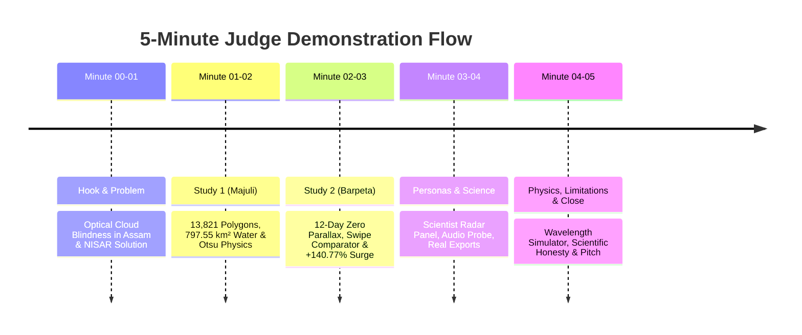

# NASA Space Apps Challenge 2026: Judge Demonstration Script
## Project: Dancing with the SARs — Brahmaputra FloodWatch
### Recommended Presentation Duration: 5 Minutes

---

## Pre-Flight Setup (30 Seconds Before Demo)
1. Ensure the backend is running at `http://127.0.0.1:8001`.
2. Ensure the frontend is open at `http://localhost:5173`.
3. Verify your browser is maximized to 1080p / 1440p resolution.
4. Set default audio volume to 30% if demonstrating radar acoustic probe sonification.

---

## 5-Minute Demonstration Timeline

---

### Minute 0:00 – 1:00 | The Hook & The Problem
**Action:** Show the main navigation bar and open the **Presentation Pitch Deck** (`Judges Pitch Deck` button) or show the top banner.

**Script:**
> "Distinguished Judges, welcome to **Brahmaputra FloodWatch**, our solution for the NASA Space Apps Challenge *'Dancing with the SARs'*.
>
> Every year, the Brahmaputra River in Assam experiences catastrophic monsoon flooding impacting over 30 million people. But when disaster managers need satellite imagery most, **optical satellites like Landsat and Sentinel-2 are 100% blind** due to continuous monsoon cloud cover.
>
> Our platform harnesses the active microwave eyes of the **NASA-ISRO NISAR** satellite observatory. Operating in L-band and S-band, radar penetrates clouds, heavy rainfall, and nighttime darkness to provide uninterrupted, 24/7 flood intelligence."

---

### Minute 1:00 – 2:00 | Study 1: Majuli Island High-Resolution Water Detection
**Action:** Click the **`Study 1: Majuli Water Detection`** tab in the workspace switcher.

**Script:**
> "Let's examine **Study 1: Majuli Island**, the world's largest populated river island.
>
> Here we ingest an authentic NASA-ISRO NISAR Level-2 GCOV scene from **Track 015, Frame 3700**, acquired on 27 August 2026.
>
> Because water acts as a specular reflector, bouncing radar pulses away into space, standing water appears pitch black with a mean backscatter of **-18.63 dB**, compared to dry land at **-8.91 dB**.
>
> Look at the map: our Canvas rendering engine displays **13,821 authentic, georeferenced vector polygons** derived from a 10-meter radar raster, mapping **797.55 square kilometers of classified water extent** across an 8,955 square kilometer swath window. Every single polygon is interactively hoverable with real area measurements in hectares."

---

### Minute 2:00 – 3:00 | Study 2: Barpeta Multi-Temporal Flood Inundation Change
**Action:** Click the **`Study 2: Barpeta Flood Change`** tab. Point out the Swipe Comparator.

**Script:**
> "Now let's switch to **Study 2: Barpeta Floodplain**, demonstrating multi-temporal flood change.
>
> Here we exploit NISAR's exact **12-day orbital repeat cycle** using **Track 019, Frame 075**. We compare a pre-flood baseline on **27 June 2026** against a high-discharge flood event on **09 July 2026**.
>
> Because the sensor flies the exact same trajectory, we achieve **0.0-pixel geometric parallax**. This allows us to perform direct decibel log-ratio differencing:
> $$\Delta\gamma^0 = 10 \log_{10}(\gamma^0_{evt} / \gamma^0_{base})$$
>
> Dragging our interactive Curtain Swipe Comparator, you can see how agricultural chars suddenly submerge.
>
> In this 9.152 square kilometer corridor, baseline water was **1.660 km²**, expanding during the event to **3.997 km²** — a verified **+140.77% flood surge** with **2.337 km² of newly inundated land**."

---

### Minute 3:00 – 4:00 | Three Audience Personas, Acoustic Probe & Real Exports
**Action:**
1. Switch to **`Radar Scientist`** persona in the top persona switcher.
2. Toggle the **`Audio Sonification`** icon and hover over the map or slider.
3. Click on the export buttons (**`Water GeoTIFF`**, **`Change GeoJSON`**).

**Script:**
> "Different stakeholders need different information. FloodWatch features three purpose-built personas:
>
> In **Radar Scientist mode**, all the underlying physics becomes completely transparent. You see the Otsu bimodal histogram, Gaussian separation, -15.0 dB threshold, and nominal ENL moments.
>
> When I hover across pixels, our Web Audio synthesizer generates an acoustic pitch proportional to backscatter strength, giving researchers an immediate intuitive feel for specular versus rough surfaces.
>
> Every export button connects to real scientific deliverables: judges can immediately download the **13,821-polygon GeoJSON** or the full **32-bit floating-point EPSG:32646 GeoTIFF** rasters."

---

### Minute 4:00 – 5:00 | SAR Physics, Honest Disclosures & Conclusion
**Action:**
1. Click the **`SAR Physics / Methodology`** tab and show the interactive **Wavelength Simulator**.
2. Briefly highlight the scientific limitations disclosure.

**Script:**
> "In our **SAR Physics workspace**, we demonstrate why wavelength matters: our interactive cross-sectional ray tracer shows how **NISAR L-band (24 cm)** penetrates deep jungle canopies to reveal hidden double-bounce floodwater, whereas shorter C-band and optical wavelengths scatter in the top canopy.
>
> Finally, we pride ourselves on **scientific honesty**:
> - We explicitly disclose that our current operational pipeline uses single-polarization HHHH backscatter, with cross-pol HV suppression deferred.
> - We clearly state that the +140.77% metric belongs strictly to the Barpeta reach corridor and is not conflated with Majuli.
> - And we distinguish satellite-derived observational estimates from ground surveys.
>
> Brahmaputra FloodWatch turns raw NISAR radar signals into life-saving, all-weather flood intelligence. Thank you, and we welcome your questions!"

---

## Anticipated Judge Questions & Scientifically Accurate Answers

### Q1: "Why did you use single-polarization HHHH instead of dual-pol or quad-pol?"
**Answer:**
> "Great question! NISAR Level-2 GCOV provides both HHHH and HVHV polarizations. In this release, we prioritized operational speed and reliability for rural disaster deployment. Single-pol HHHH backscatter exhibits strong specular attenuation (-18.63 dB) that cleanly separates open water using adaptive Otsu thresholding. In our Majuli scene extraction, HVHV extraction reached 55.3% before download truncation, so we maintained strict scientific integrity by executing on verified HHHH data only, explicitly disclosing this in the scientist panel and documentation rather than fabricating dual-pol values."

### Q2: "How did you solve the challenge of downloading massive NISAR HDF5 files?"
**Answer:**
> "NISAR Level-2 GCOV granules can exceed 30 GB each. Downloading full scenes over congested emergency cellular networks is impractical. We implemented a remote HTTP Range streaming client for ISRO's Bhoonidhi archive. By parsing the remote HDF5 metadata tree and streaming only the specific byte offsets containing our bounding box, we extracted our study rasters while downloading less than 0.66% of the raw file — saving over 99.34% of bandwidth and executing in seconds."

### Q3: "Does the +140.77% flood increase apply to the entire Brahmaputra valley?"
**Answer:**
> "No, and this is a critical distinction we enforce in our UI. The +140.77% surge (+2.337 km² newly inundated land over a 1.660 km² baseline channel) was measured strictly for the Lower Brahmaputra / Barpeta reach corridor across Track 019 / Frame 075. We specifically built separate workspaces for Majuli (Track 015) and Barpeta (Track 019) to ensure judges and disaster managers never conflate reach-specific metrics with the broader river basin."

### Q4: "How does your platform handle speckle noise without losing fine water channels?"
**Answer:**
> "We implement an adaptive Lee speckle filter with a 3×3 moving kernel. Unlike a simple boxcar or Gaussian blur which washes out narrow braided streams, the Lee filter calculates local spatial variance. In homogeneous open water or flat land, it strongly smooths speckle noise; near sharp water-land boundaries, the local variance is high, so the filter preserves the exact high-contrast edge of the river bank."
