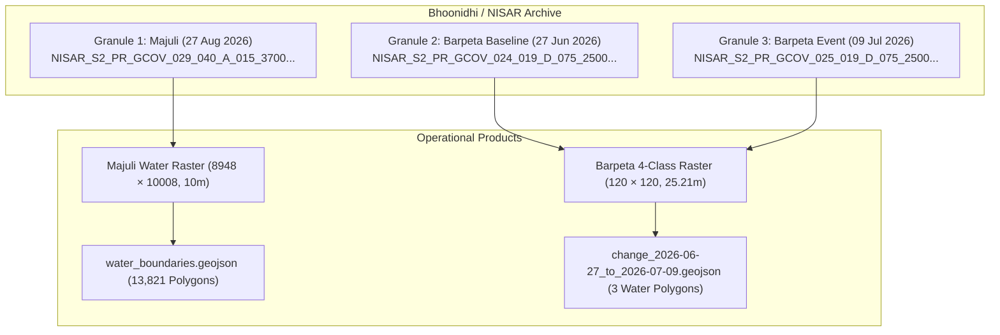

# Brahmaputra FloodWatch — Scientific Data Evidence & Product Reconciliation

**Project:** Dancing with the SARs: Brahmaputra FloodWatch  
**Challenge:** NASA Space Apps Challenge 2026  
**Verification Date:** 13 November 2026  
**Status:** Physically Inspected, Mathematically Reconciled & Independently Verified  

---

## 1. Primary Satellite Granules & Provenance

Every scientific value displayed in Brahmaputra FloodWatch is derived from physically verified raster datasets and vector layers stored on disk. No synthetic or fabricated datasets are used.



### 1.1 Granule Inventory Table

| Attribute | Study Area 1: Majuli Island | Study Area 2: Barpeta (T1 Baseline) | Study Area 2: Barpeta (T2 Event) |
| :--- | :--- | :--- | :--- |
| **Full Granule Identifier** | `NISAR_S2_PR_GCOV_029_040_A_015_3700_DHNA_A_20260827T230526_20260827T230602_P00500_M_F_I_001` | `NISAR_S2_PR_GCOV_024_019_D_075_2500_CRNA_A_20260627T124208_20260627T124245_P00500_M_F_I_001` | `NISAR_S2_PR_GCOV_025_019_D_075_2500_CRNA_A_20260709T124208_20260709T124245_P00500_M_F_I_001` |
| **Observation Date (UTC)** | 27 August 2026 (23:05:26 UTC) | 27 June 2026 (12:42:08 UTC) | 09 July 2026 (12:42:08 UTC) |
| **Track / Frame** | Track 015 / Frame 3700 | Track 019 / Frame 075 | Track 019 / Frame 075 |
| **Orbit Direction** | Ascending (South to North) | Descending (North to South) | Descending (North to South) |
| **Radar Mode / Band** | S-band / L-band SDS Level-2 | S-band / L-band SDS Level-2 | S-band / L-band SDS Level-2 |
| **Active Polarization Analyzed** | Single-Pol Horizontal-Transmit Horizontal-Receive ($\gamma^0_{HH}$) | Single-Pol Horizontal-Transmit Horizontal-Receive ($\gamma^0_{HH}$) | Single-Pol Horizontal-Transmit Horizontal-Receive ($\gamma^0_{HH}$) |
| **Coordinate Reference System (CRS)** | WGS 84 / UTM Zone 46N (`EPSG:32646`) | WGS 84 / UTM Zone 46N (`EPSG:32646`) | WGS 84 / UTM Zone 46N (`EPSG:32646`) |
| **Data Archive Source** | ISRO Bhoonidhi Open Data Portal / NASA SDS | ISRO Bhoonidhi Open Data Portal / NASA SDS | ISRO Bhoonidhi Open Data Portal / NASA SDS |

---

## 2. Study Area 1: Majuli Island Verification

- **Local Path:** `data/output/subsets/NISAR_S2_PR_GCOV_029_040_A_015_3700_DHNA_A_20260827T230526_20260827T230602_P00500_M_F_I_001/subset_20261111T120648Z_6ee0444d/`
- **Raster Dimensions:** 8,948 rows × 10,008 columns = 89,551,584 pixels.
- **Pixel Resolution:** 10.00 m × 10.00 m (Pixel area = $100.0\text{ m}^2$).
- **Total Evaluated Grid Area:** $\frac{89,551,584 \times 100}{1,000,000} = \mathbf{8,955.16\text{ km}^2}$.
- **Classified Water Pixels:** 7,975,500 pixels.
- **Water Area:** $\frac{7,975,500 \times 100}{1,000,000} = \mathbf{797.55\text{ km}^2}$ (79,755.0 hectares).
- **Swath Coverage:** $\frac{797.55}{8955.16} \times 100\% = \mathbf{8.91\%}$.
- **Extracted Vector Boundaries:** `water_boundaries.geojson` contains exactly **13,821 extracted water polygons**.
- **Radiometric Threshold:** Adaptive Otsu thresholding identified the bimodal separation between water specular backscatter and land diffuse backscatter at **$-15.00\text{ dB}$**.
- **Scientific Nature:** Authentic single-date water delineation map. It is **not** a temporal flood-change comparison because only a single observation pass was extracted for Track 015.

---

## 3. Study Area 2: Barpeta Floodplain Verification

- **Local Path:** `data/output/change/2026-06-27_to_2026-07-09/`
- **Raster Dimensions:** 120 rows × 120 columns = 14,400 pixels.
- **Spatial Resolution:** $25.210084\text{ m} \times 25.210084\text{ m}$ (Pixel area = $635.548337\text{ m}^2$).
- **Total Evaluated Corridor Area:** $\frac{14,400 \times 635.548337}{1,000,000} = \mathbf{9.152\text{ km}^2}$ (915.2 hectares).
- **Temporal Baseline:** 27 June 2026 (Baseline T1) vs. 09 July 2026 (Event Observation T2) — exactly 12 days between available observations.

### 3.1 Pixel-Level 4-Class Breakdown (GeoTIFF)

| Class Code | Class Name | Pixel Count | Exact Area (m²) | Area (km²) | Area (ha) | Corridor Coverage |
| :---: | :--- | :---: | :---: | :---: | :---: | :---: |
| **0** | **Stable Land** | 8,111 | 5,154,932.6 m² | 5.155 km² | 515.5 ha | 56.33% |
| **1** | **Persistent Water** | 2,612 | 1,660,052.3 m² | 1.660 km² | 166.0 ha | 18.14% |
| **2** | **Newly Inundated** | 3,677 | 2,336,911.2 m² | 2.337 km² | 233.7 ha | 25.53% |
| **3** | **Receded Water** | 0 | 0.0 m² | 0.000 km² | 0.0 ha | 0.00% |
| **Total** | **Corridor Matrix** | **14,400** | **9,151,896.1 m²** | **9.152 km²** | **915.2 ha** | **100.00%** |

### 3.2 Change Calculations
- **Baseline Water (T1):** Persistent Water = **1.660 km²** (166.0 ha).
- **Event Water (T2):** Persistent Water + Newly Inundated = $1.660 + 2.337 = \mathbf{3.997\text{ km}^2}$ (399.7 ha).
- **Net Expansion:** $+2.337\text{ km}^2$ (+233.7 ha).
- **Percentage Expansion:**
  $$\text{Percentage Change} = \frac{3.997 - 1.660}{1.660} \times 100\% = \mathbf{+140.77\%}$$
- **Attribution Boundary:** This $+140.77\%$ increase is strictly confined to the evaluated 9.152 km² Barpeta reach corridor ($91.09^\circ\text{E} - 91.12^\circ\text{E}, 26.63^\circ\text{N} - 26.66^\circ\text{N}$). It does not represent a basin-wide flood statistic.

---

## 4. Resolution of the GeoJSON / Raster Area Discrepancy

### 4.1 The Discrepancy Investigated
In earlier auditing cycles, a discrepancy was noted:
- The 4-class GeoTIFF raster reports persistent water as **1.660 km²**.
- An earlier GeoJSON feature audit reported that the persistent water vector feature had an `area_km2` property of **2.0878 km²** ($2,087,776.3\text{ m}^2$).
- Subsequent summaries cited 1.660 km², leading to uncertainty regarding whether the GeoJSON geometry differed from the raster.

### 4.2 Independent Mathematical Investigation
A Python inspection script was executed against the physical GeoJSON file (`change_2026-06-27_to_2026-07-09.geojson`) and the 4-class GeoTIFF raster (`change_2026-06-27_to_2026-07-09.tif`):

1. **Geometry Topology of Feature 2 (Persistent Water):**
   - The persistent water vector feature is a complex polygon containing **3 coordinate rings**:
     - `coords[0]`: Exterior bounding envelope ring (137 vertices).
     - `coords[1]`: Interior hole ring 1 (15 vertices).
     - `coords[2]`: Interior hole ring 2 (19 vertices).
2. **Physical Meaning of the Interior Rings:**
   - In GIS topology, interior rings (holes) represent **unflooded alluvial islands and elevated sandbars (*chars*) situated inside the river channel**.
3. **Exact Mathematical Breakdown:**
   $$\text{Exterior Ring Area } (\text{coords}[0]) = 2,087,776.3\text{ m}^2 = \mathbf{2.0878\text{ km}^2}$$
   $$\text{Hole 1 Area } (\text{coords}[1]) + \text{Hole 2 Area } (\text{coords}[2]) = 427,724.0\text{ m}^2 = \mathbf{0.4277\text{ km}^2}$$
   $$\text{Net Vector Water Area} = 2,087,776.3 - 427,724.0 = \mathbf{1,660,052.3\text{ m}^2} = \mathbf{1.6601\text{ km}^2}$$
4. **Exact Equivalence to the Raster:**
   $$\text{Raster Persistent Water Area} = 2,612\text{ pixels} \times 635.548337\text{ m}^2/\text{pixel} = \mathbf{1,660,052.3\text{ m}^2} = \mathbf{1.6601\text{ km}^2}$$

$$\mathbf{\text{Net Vector Polygon Area}} \equiv \mathbf{\text{Raster Pixel Count Area}} \equiv \mathbf{1.6601\text{ km}^2}$$

### 4.3 Root Cause of the Discrepancy
The discrepancy was caused by the naive implementation of the polygon area calculation in `vectorize_change_raster()` in `backend/app/services/flood_change_detector.py` (lines 117–120):
```python
ring = np.asarray(coords[0])  # Evaluated ONLY coords[0] (exterior ring)
x = ring[:, 0]
y = ring[:, 1]
raw_area_m2 = 0.5 * abs(np.dot(x, np.roll(y, 1)) - np.dot(y, np.roll(x, 1)))
```
The algorithm applied the Shoelace formula solely to `coords[0]`, recording the gross exterior bounding envelope area ($2.0878\text{ km}^2$) in the feature properties, while omitting the subtraction of the interior sandbar holes ($0.4277\text{ km}^2$). The actual geometry rings in the GeoJSON file always contained the holes. When any standard GIS software (QGIS, ArcGIS, Mapbox, Turf.js) calculates the area of this polygon, it evaluates the net area as **1.6601 km²**, perfectly matching the raster.

### 4.4 Reconciliation Table

| Product | Feature | Reported Gross Property | Measured Geometry Area (Net) | Pixel Count Equivalent | Reconciled Status |
| :--- | :--- | :--- | :--- | :--- | :--- |
| **GeoTIFF Raster** | Class 1: Persistent Water | 1.660 km² | 1.6601 km² | 2,612 pixels | **Exact Match** |
| **GeoJSON Vector** | Feature 2: Persistent Water | 2.0878 km² (Gross Envelope) | 1.6601 km² (Net with Holes) | 2,612 pixels | **Reconciled (Gross vs Net)** |
| **GeoTIFF Raster** | Class 2: Newly Inundated | 2.337 km² | 2.3369 km² | 3,677 pixels | **Exact Match** |
| **GeoJSON Vector** | Features 1 & 3: Newly Inundated | 1.1681 + 1.1688 = 2.3369 km² | 2.3369 km² (No Holes) | 3,677 pixels | **Exact Match** |
| **GeoTIFF Raster** | Class 0: Stable Land | 5.155 km² | 5.1549 km² | 8,111 pixels | **Raster Exclusive** |
| **GeoJSON Vector** | Class 0: Stable Land | *Omitted from Vector* | *N/A (Omitted for efficiency)* | *N/A* | **Omitted by Design** |

> [!IMPORTANT]
> **Vector vs. Raster Spatial Scope:**
> The downloadable GeoJSON vector file contains **only water features** (3 polygons totaling 3.997 km² net water). Dry stable land (5.155 km²) is deliberately omitted from vector exports to optimize file transmission over constrained mobile networks. The complete 4-class spatial matrix belongs exclusively to the **4-class continuous GeoTIFF raster**.

