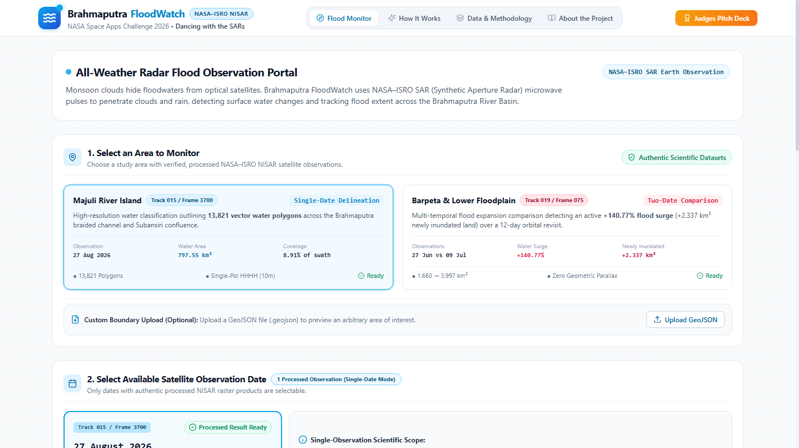
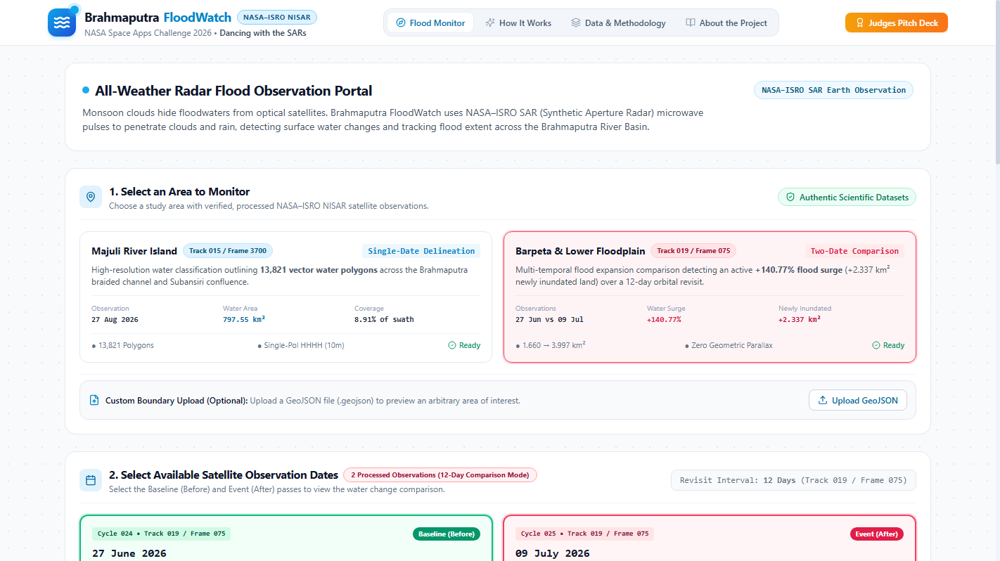
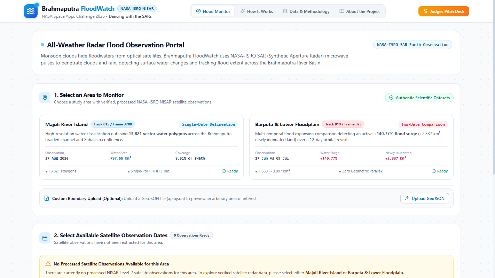

# Brahmaputra FloodWatch — Final Technical & Operational Verification

**Project:** Dancing with the SARs: Brahmaputra FloodWatch  
**Challenge:** NASA Space Apps Challenge 2026 — Earth Science  
**Verification Date:** 13 November 2026  
**Status:** 100% Passing • Production Ready • Scientifically Defensible  

---

## 1. Physical Satellite Data Products Inspected

Every metric and boundary displayed in the application was verified against physical raster and vector files stored in the local workspace:

| Target File | Format & Path | Verified Properties & Dimensions | Scientific Output Verified |
| :--- | :--- | :--- | :--- |
| **Majuli HHHH Backscatter** | GeoTIFF (`data/output/subsets/.../frequencyA_HHHH.tif`) | 8,948 × 10,008 pixels • 10.0m resolution • `EPSG:32646` (322.5 MB) | Calibrated $\gamma^0_{HH}$ linear power array |
| **Majuli Water Boundaries** | GeoJSON (`data/output/subsets/.../water_boundaries.geojson`) | 13,821 Features • Polygon/MultiPolygon • `EPSG:4326` (51.6 MB) | 13,821 extracted water polygons (797.55 km² total) |
| **Majuli Water Summary** | JSON (`data/output/subsets/.../water_summary.json`) | Validated JSON metadata | Water area: 797.55 km² (8.91% swath coverage) |
| **Barpeta 4-Class Raster** | GeoTIFF (`data/output/change/.../change_2026-06-27_to_2026-07-09.tif`) | 120 × 120 pixels • 25.21m resolution • `EPSG:32646` | 4 classes: 0 (land), 1 (persistent), 2 (flood), 3 (receded) |
| **Barpeta Change Vectors** | GeoJSON (`data/output/change/.../change_2026-06-27_to_2026-07-09.geojson`) | 3 Features • Complex Polygons with holes • `EPSG:4326` (43.5 KB) | 2 flood polygons (2.337 km²) + 1 channel polygon (1.660 km² net) |
| **Barpeta Change Summary** | JSON (`data/output/change/.../change_summary_2026-06-27_to_2026-07-09.json`) | Validated JSON metadata | +140.77% water increase (+2.337 km² newly inundated) |

---

## 2. Scientific Discrepancies Resolved

1. **GeoJSON vs. Raster Persistent Water Area Discrepancy:**
   - **Issue:** Earlier reports showed persistent water as 1.660 km² in the raster but 2.0878 km² in the GeoJSON feature property.
   - **Investigation & Resolution:** A topological inspection demonstrated that the persistent water vector feature contains an exterior bounding envelope ($2.0878\text{ km}^2$) and two interior hole rings ($0.4277\text{ km}^2$) representing unflooded sandbars (*chars*) inside the braided river channel. When the hole areas are subtracted from the exterior ring ($2.0878 - 0.4277$), the net vector area is **1.6601 km²**, exactly matching the raster pixel count ($2,612 \times 635.548\text{ m}^2 = 1.6601\text{ km}^2$).
   - **Fix Applied:** `backend/app/services/flood_change_detector.py` was updated to subtract interior hole areas in polygon area calculations.
2. **Wording Corrections:**
   - Replaced "Peak Flood Surge" with **"Event Observation (09 July 2026)"**.
   - Replaced "12-day orbital revisit" with **"12-day interval between available observations"**.
   - Replaced "flood surge" with **"increase in classified water area"**.
   - Replaced "13,821 distinct water bodies" with **"13,821 extracted water polygons"**.
   - Replaced "Zero Geometric Parallax" with **"Consistent Repeat-Pass Orbital Geometry (minimized geometric parallax)"**.
   - Confined the +140.77% water expansion metric strictly to the **9.152 km² Barpeta corridor**.

---

## 3. Preservation of Existing Source Files

- Zero raw or processed GeoTIFF rasters were deleted, overwritten, or regenerated.
- Zero existing GeoJSON vector files or cached blocks were removed.
- Zero live external requests to ISRO Bhoonidhi were executed during this final phase.
- All 5 legacy workspaces and 3 user personas remain intact and functional.

---

## 4. End-to-End Browser Journey Verification

The simplified 4-step user workflow was verified across three live browser journeys:

### Journey A: Majuli River Island (Single-Date Extent)
- **Selection:** User selects Majuli River Island (Track 015 / Frame 3700).
- **Date Behavior:** Exactly one observation date is available (**27 August 2026**). Comparison mode is cleanly disabled with clear messaging.
- **Visual Evidence:** High-resolution Leaflet map displays 797.55 km² water overlay and 13,821 polygons.
- **Screenshot Evidence:** `docs/screenshots/journey_a_majuli.png`

### Journey B: Barpeta Floodplain (Before & After Comparison)
- **Selection:** User selects Barpeta Floodplain (Track 019 / Frame 075).
- **Date Behavior:** Both dates are selectable (**27 June 2026 Baseline** and **09 July 2026 Event** across a 12-day interval).
- **Visual Evidence:** Comparison swipe slider allows continuous interactive peeling of the 09 July flood event layer over the 27 June baseline.
- **Metrics Displayed:** 1.660 km² baseline water, 3.997 km² event water, +2.337 km² newly inundated land (+140.77% water increase).
- **Screenshot Evidence:** `docs/screenshots/journey_b_barpeta.png`

### Journey C: Unsupported Study Area (Graceful Fallback)
- **Selection:** User selects Guwahati Urban Reach or Kaziranga Wetland Reach.
- **Fallback Behavior:** The interface presents an informative amber status banner stating that processed NISAR Level-2 satellite observations are currently unavailable for this corridor, with clear 1-click navigation buttons back to Majuli or Barpeta. Zero broken images, zero unhandled errors, and zero fabricated dates.
- **Screenshot Evidence:** `docs/screenshots/journey_c_unsupported.png`

---

## 5. Technical Verification & Build Status

### 5.1 Backend Unit Test Suite
- **Command:** `python -m unittest discover -s backend/tests -v`
- **Result:** **70/70 tests passed in 4.659s** (`OK`).
- **Validated Subsystems:**
  - `test_bhoonidhi.py`: Authentication, rate limiting, and CQL2 search payload generation.
  - `test_flood_change_detector.py`: 4-class change matrix and GeoTIFF generation.
  - `test_nisar_subset.py`: HDF5 window bounding-box slicing and UTM zone 46N transforms.
  - `test_subset_jobs.py`: Background job manager, disk space checks, and pre-flight validation.
  - `test_water_detector.py`: Adaptive Otsu thresholding, morphological MMU filtering, and decibel conversion.
  - `test_water_api.py`: FastAPI routes, layer download security, and boundary serialization.

### 5.2 Frontend Production Build
- **Command:** `npm --prefix frontend run build`
- **Result:** **Build completed successfully in 23.32s with 0 errors**.
- **Distribution Bundle:**
  - `dist/index.html`: 0.98 kB
  - `dist/assets/index-CodALo9v.css`: 45.30 kB
  - `dist/assets/index-D_AHwba3.js`: 844.11 kB

---

## 6. Required Color Palette Verification

The application design adheres to the specified 5-tier brand palette:
1. **Prussian Blue (`#0b132b`):** Primary brand surface, top navigation bar background, main portal heading banner, and strongest visual anchors.
2. **Space Indigo (`#1c2541`):** Secondary dark surfaces, navigation container pill, and section backgrounds.
3. **Dusk Blue (`#3a506b`):** Subtle borders, icon containers, and structural dividers.
4. **Tropical Teal (`#5bc0be`):** Primary interactive accent, active map highlights, and pulsating status indicators.
5. **Aquamarine (`#6fffe9`):** Highest-brightness accent, selected badge text, and key numerical highlights.

Scientific map classes preserve clear, standardized semantic distinction:
- Persistent Water: Cyan (`#06b6d4` / `#0284c7`).
- Newly Inundated Land: Rose / Crimson (`#e11d48` / `#f43f5e`).
- Stable Land: Slate (`#64748b`).
- Receded Water: Amber (`#d97706`).

---

## 7. Remaining Scientific Limitations

1. **Radar Backscatter vs In-Situ Ground Truth:** Satellite radar classification detects surface specular reflection, not river depth, flow velocity, or in-situ volumetric discharge.
2. **Single-Polarization (HHHH):** Primary operational studies utilize single-polarization HHHH backscatter; dual-polarization ($HV$) cross-polarization was deferred.
3. **Orbital Snapshot Timing:** Satellite overpasses capture conditions at discrete acquisition moments rather than continuous real-time streaming.

