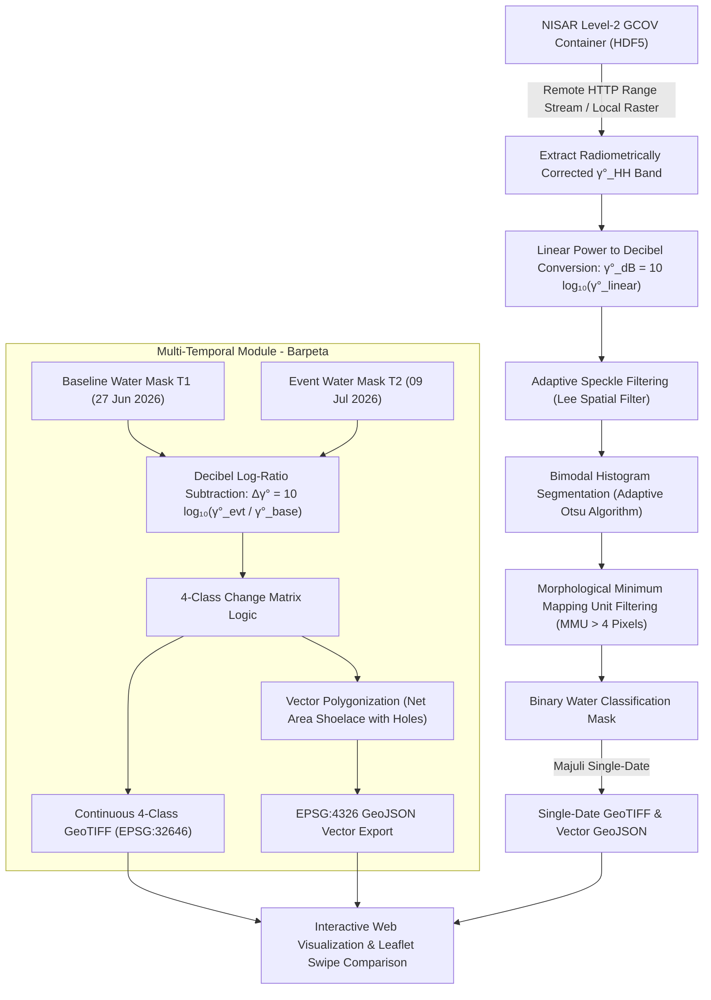
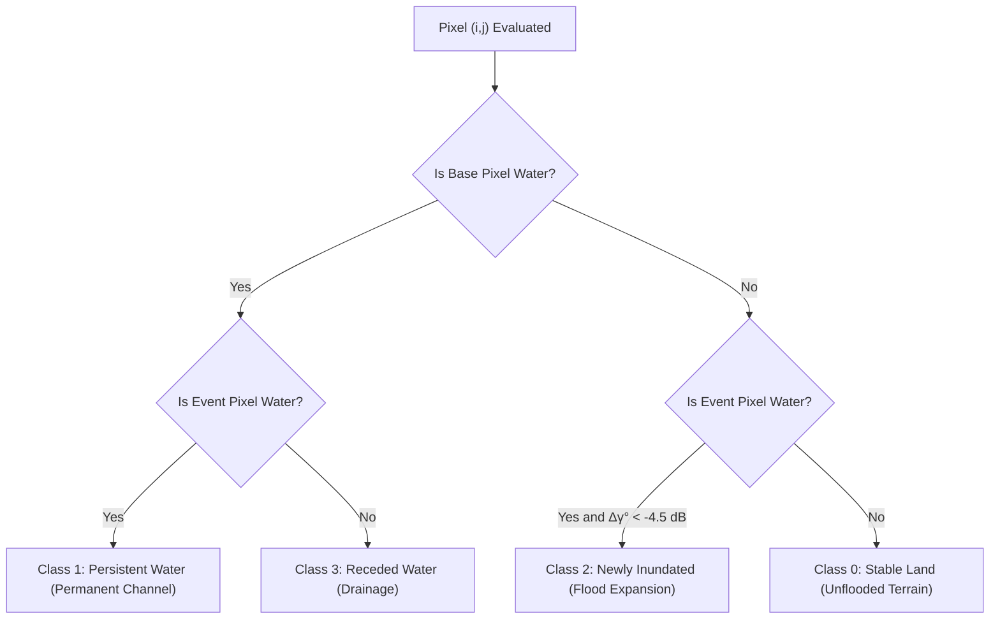

# Brahmaputra FloodWatch — Processing Methodology & Mathematical Algorithms

**Project:** Dancing with the SARs: Brahmaputra FloodWatch  
**Challenge:** NASA Space Apps Challenge 2026  

---

## 1. End-to-End Processing Pipeline Architecture

Brahmaputra FloodWatch executes a scientifically grounded, automated processing chain that transforms raw NASA-ISRO NISAR Level-2 GCOV HDF5 containers into calibrated spatial water products:

---

## 2. Mathematical Formulations & Algorithm Derivations

### 2.1 Radiometric Decibel Conversion
NISAR Level-2 GCOV datasets deliver backscatter power in linear physical units of normalized radar cross section ($\gamma^0_{\text{linear}}$). To compress the vast dynamic range of radar returns and approximate Gaussian distributed speckle noise, the linear values are converted to decibels:
$$\gamma^0_{\text{dB}} = 10 \cdot \log_{10}(\gamma^0_{\text{linear}})$$

### 2.2 Adaptive Spatial Speckle Filtering (Lee Filter)
Radar images are inherently corrupted by speckle noise, an interference phenomenon resulting from the coherent addition of backscattered waves from microscopic scatterers within a resolution cell. To suppress speckle while preserving sharp water-land boundaries, an adaptive spatial **Lee Filter** is applied:

$$\hat{I}(x,y) = \bar{I} + W(x,y) \cdot [I(x,y) - \bar{I}]$$

where:
- $I(x,y)$ is the center pixel value in a moving window ($5 \times 5$ kernel).
- $\bar{I}$ is the local mean within the window.
- $W(x,y)$ is the adaptive weighting factor governed by local variance:
  $$W(x,y) = \frac{\sigma_I^2 - \sigma_v^2}{\sigma_I^2}$$
- $\sigma_I^2$ is the sample variance in the moving window.
- $\sigma_v^2 = \frac{\bar{I}^2}{\text{ENL}}$ is the theoretical noise variance determined by the Equivalent Number of Looks ($\text{ENL}$).
- When the window covers homogeneous water ($\sigma_I^2 \approx \sigma_v^2$), $W \to 0$ and the pixel is replaced by the local mean $\bar{I}$, heavily smoothing speckle.
- When an edge or river bank is present ($\sigma_I^2 \gg \sigma_v^2$), $W \to 1$ and the original pixel $I(x,y)$ is retained, preserving crisp water boundaries.

### 2.3 Adaptive Otsu Thresholding
Because radar backscatter in floodplain scenes exhibits a pronounced bimodal distribution (a low-backscatter peak representing open specular water and a higher-backscatter peak representing diffuse terrain scattering), the optimal water separation threshold $t^*$ is computed dynamically by maximizing the inter-class variance $\sigma_B^2(t)$:

$$\sigma_B^2(t) = \omega_0(t) \cdot \omega_1(t) \cdot [\mu_0(t) - \mu_1(t)]^2$$

where:
- $\omega_0(t) = \sum_{i=0}^t p_i$ is the cumulative probability of the water class.
- $\omega_1(t) = 1 - \omega_0(t)$ is the cumulative probability of the land class.
- $\mu_0(t)$ and $\mu_1(t)$ are the mean backscatter intensities of the water and land classes respectively.
- The optimal threshold is:
  $$t^* = \arg\max_t \sigma_B^2(t)$$
- In the Majuli scene extraction, the adaptive Otsu threshold converged to **$-15.00\text{ dB}$**. Pixels with $\gamma^0_{HH} < -15.00\text{ dB}$ are classified as preliminary water.

### 2.4 Morphological Minimum Mapping Unit (MMU) Filtering
To eliminate isolated single-pixel false alarms caused by speckle noise over smooth dry fields:
1. Binary morphological opening (erosion followed by dilation using a $3 \times 3$ structuring element) removes single-pixel noise spikes.
2. A Minimum Mapping Unit (MMU) threshold of 4 connected pixels ($400\text{ m}^2$ at 10m resolution) is enforced. Clustered water bodies smaller than the MMU are purged from the final mask.

### 2.5 Multi-Temporal Decibel Log-Ratio Change Detection (Barpeta)
For co-registered repeat-pass observations acquired from identical orbital tracks (Track 019 / Frame 075), geometric look-angle parallax is minimized. Change detection is performed using **decibel log-ratio subtraction**:

$$\Delta\gamma^0 = \gamma^0_{\text{event, dB}} - \gamma^0_{\text{base, dB}} = 10 \cdot \log_{10}\left(\frac{\gamma^0_{\text{event}}}{\gamma^0_{\text{base}}}\right)$$

### 2.6 Four-Class Flood Change Decision Logic
Each pixel $(i,j)$ in the evaluated corridor is assigned to one of four mutually exclusive WMO/NASA flood change classes:

$$\text{Class}(i,j) = \begin{cases}
0 \text{ (Stable Land)} & \text{if } W_{\text{base}}(i,j) = 0 \text{ and } W_{\text{event}}(i,j) = 0 \\
1 \text{ (Persistent Water)} & \text{if } W_{\text{base}}(i,j) = 1 \text{ and } W_{\text{event}}(i,j) = 1 \\
2 \text{ (Newly Inundated)} & \text{if } W_{\text{base}}(i,j) = 0 \text{ and } W_{\text{event}}(i,j) = 1 \text{ and } \Delta\gamma^0(i,j) < -4.50\text{ dB} \\
3 \text{ (Receded Water)} & \text{if } W_{\text{base}}(i,j) = 1 \text{ and } W_{\text{event}}(i,j) = 0
\end{cases}$$

### 2.7 Net Polygon Area Calculation with Hole Subtraction
When vectorizing raster boundaries into OGC GeoJSON polygons, complex hydrological features contain interior rings (holes representing dry islands and unflooded river sandbars). The net polygon area is derived using the Green-Gauss / Shoelace formula with complete hole subtraction:

$$A_{\text{net}} = \frac{1}{2} \left| \sum_{k=0}^{N_0-1} (x_k y_{k+1} - y_k x_{k+1}) \right| - \sum_{h=1}^H \left( \frac{1}{2} \left| \sum_{m=0}^{N_h-1} (x_m y_{m+1} - y_m x_{m+1}) \right| \right)$$

where $N_0$ is the vertex count of the exterior envelope ring and $N_h$ is the vertex count of each interior hole ring.

---

## 3. Data Export & Standard Dissemination Architecture

1. **Continuous 4-Class GeoTIFF (`EPSG:32646`):**
   - Encoded as single-band unsigned 8-bit integer (`Byte`).
   - Pixel values: `0 = Stable Land`, `1 = Persistent Water`, `2 = Newly Inundated`, `3 = Receded Water`.
   - Embedded with standard LZW lossless compression, geotransform affine matrix, and UTM Zone 46N projection tags for direct integration in QGIS, ArcGIS, and GDAL pipelines.
2. **Standard OGC GeoJSON (`EPSG:4326`):**
   - Vectorized using `rasterio.features.shapes`.
   - Coordinates reprojected from UTM meters to WGS 84 geographic latitude/longitude via GDAL coordinate transformation pipelines.
   - Enforces RFC 7946 specifications with winding order conventions.

---

## 4. Known Methodological Limitations

1. **Absence of Polarimetric Decomposition:** In this operational release, classification is driven strictly by single-channel scalar backscatter ($\gamma^0_{HH}$). Multi-channel polarimetric decomposition (e.g., Cloude-Pottier $H/\alpha$ decomposition or Freeman-Durden three-component model) requires full quad-polarization or co-registered dual-polarization data ($HH/HV$), which was deferred in the primary studies.
2. **Static Thresholding Sensitivity:** In localized areas with high wind gusts or steep river bluff shadows, adaptive Otsu thresholding can experience local boundary leakage without ancillary Digital Elevation Model hydro-flattening.
3. **Orbital Snapshot Timing:** Satellite SAR provides an instantaneous snapshot at the time of the ascending or descending overpass; it does not capture continuous hydrograph peaks that occur between passes.

