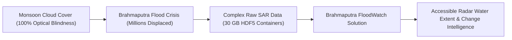

# Brahmaputra FloodWatch — Project Overview

**Project Title:** Dancing with the SARs: Brahmaputra FloodWatch  
**Challenge:** NASA Space Apps Challenge 2026 — Earth Science / *Dancing with the SARs*  
**Platform:** Web Application (React + Vite, Tailwind CSS, Leaflet, FastAPI, Rasterio, NumPy)  
**Target Region:** Brahmaputra River Basin, Assam, Northeast India  
**Satellite Mission:** NASA-ISRO Synthetic Aperture Radar (NISAR)  

---

## 1. Concise Problem Statement

During the annual South Asian monsoon, the Brahmaputra River in Assam undergoes severe flooding, submerging agricultural sandbars (*chars*), displacing millions of vulnerable residents, and threatening wildlife in critical riverine sanctuaries such as Kaziranga National Park. 

During these critical disaster periods, **conventional optical satellites (such as Landsat and Sentinel-2) are 100% blind** due to continuous, dense monsoonal cloud decks. While active microwave Synthetic Aperture Radar (SAR) can penetrate cloud cover day and night, raw radar data products—such as multi-gigabyte Level-2 GCOV (Geocoded Polarimetric Covariance) containers—are mathematically complex, bandwidth-prohibitive for field responders, and difficult for non-specialists to interpret. 

---

## 2. Solution Overview

**Brahmaputra FloodWatch** bridges the gap between raw satellite telemetry and actionable flood intelligence. It is a user-driven Earth observation web platform that processes authentic NASA-ISRO NISAR Level-2 GCOV observations to deliver:

1. **All-Weather Water Delineation:** High-contrast specular reflection mapping that reveals standing water through cloud cover and precipitation.
2. **Multi-Temporal Surface-Water Change Detection:** Co-registered repeat-pass decibel log-ratio comparisons ($\Delta\gamma^0 = 10 \log_{10}(\gamma^0_{\text{event}} / \gamma^0_{\text{base}})$) that quantify new inundation across low-lying agricultural corridors.
3. **Bandwidth-Optimized Data Streaming:** A remote HTTP Range streaming architecture that extracts localized study bounding boxes directly from HDF5 archives without downloading entire multi-gigabyte granules (achieving up to 99.34% bandwidth savings).
4. **Transparent, Evidence-Based Spatial Delivery:** Interactive swipe comparisons, plain-English change explanations, and direct downloads of standardized continuous 4-class GeoTIFF rasters and OGC GeoJSON vector boundaries.

---

## 3. Target Users & Real-World Use Cases

| User Group | Practical Real-World Workflow | Application Value |
| :--- | :--- | :--- |
| **Disaster Response Coordinators** (e.g., ASDMA / NDRF) | Identify flooded agricultural chars, compromised embankment sectors, and cut-off transportation routes during active storms. | Rapid assessment of newly inundated land without waiting for clear skies or flying drones in adverse weather. |
| **Hydrological & Climate Researchers** | Study braided channel migration, seasonal wetland dynamics, and flood-corridor water expansion over multi-day repeat passes. | Rigorous, calibrated Level-2 GCOV backscatter values ($\gamma^0_{HH}$ in dB) and downloadable 4-class GeoTIFF rasters. |
| **Agricultural & Community Advocates** | Assess submerged crop acreage across riverine char settlements to plan relief distribution and compensation claims. | Plain-English summaries and accessible visual maps indicating exactly what land changed. |
| **Students & Citizen Scientists** | Learn radar remote sensing fundamentals, wave-surface interaction physics, and microwave penetration capabilities. | Interactive educational tabs, wavelength comparisons (L-band vs C-band vs Optical), and transparent scientific notes. |

---

## 4. Main Demonstrated Capabilities

Brahmaputra FloodWatch is structured around three concrete, demonstrated capabilities grounded in actual satellite data:

### Capability 1: Single-Date High-Resolution Water Extent (Majuli Island)
- **Observation:** 27 August 2026 (Track 015 / Frame 3700, Ascending Pass).
- **Processing:** Single-polarization Horizontal-Transmit Horizontal-Receive (HHHH) backscatter ($\gamma^0_{HH}$) calibrated at 10.0 m grid spacing over an 8,955.16 km² UTM Zone 46N bounding window.
- **Result:** Adaptive Otsu thresholding (-15.0 dB cutoff) delineated **797.55 km²** of surface water (8.91% of swath) and extracted **13,821 discrete water polygons** encompassing the braided Brahmaputra channels and northern Subansiri river confluence.

### Capability 2: Multi-Temporal Water Change Detection (Barpeta Floodplain)
- **Observations:** 27 June 2026 (Baseline T1) vs. 09 July 2026 (Event T2) across a 12-day interval between available observations.
- **Repeat Pass:** Track 019 / Frame 075 (Descending Pass).
- **Result:** Log-ratio decibel change detection ($\Delta\gamma^0 < -4.50\text{ dB}$) across a 9.152 km² river corridor revealed an increase in classified water area from **1.660 km²** (166.0 ha) to **3.997 km²** (399.7 ha)—a **+140.77% water expansion** (+2.337 km² newly inundated agricultural land).

### Capability 3: Transparent Evidence-Based Monitoring (Unsupported Reaches)
- When a user selects study areas where processed NISAR observations are currently unavailable (such as Guwahati Urban Reach or Kaziranga Wetland Reach), the application displays a clear status banner explaining data availability rather than fabricating synthetic observations or dates.

---

## 5. What Makes Brahmaputra FloodWatch Distinctive

1. **Authentic Space Agency Data Integration:** Operates directly on NASA-ISRO NISAR Level-2 GCOV products rather than simulated or synthetic imagery.
2. **HTTP Range HDF5 Remote Streaming:** Incorporates an ISRO Bhoonidhi streaming client that reads byte-range headers and extracts bounding boxes on the fly, eliminating the need to download 30 GB files over limited field connections.
3. **Strict Scientific Attribution:** Distinguishes satellite radar-backscatter water delineation from in-situ flood depth or discharge measurements, and confines the +140.77% expansion metric strictly to the evaluated 9.152 km² Barpeta corridor.
4. **Co-Registered Repeat-Pass Geometry:** Leverages matched orbital tracks to minimize geometric look-angle parallax, enabling direct pixel-by-pixel decibel subtraction.
5. **Dual Spatial Deliverables:** Provides both complete 4-class continuous GeoTIFF rasters (preserving stable land and full spatial accounting) and lightweight OGC GeoJSON vector files (water polygons for rapid mobile web GIS display).

