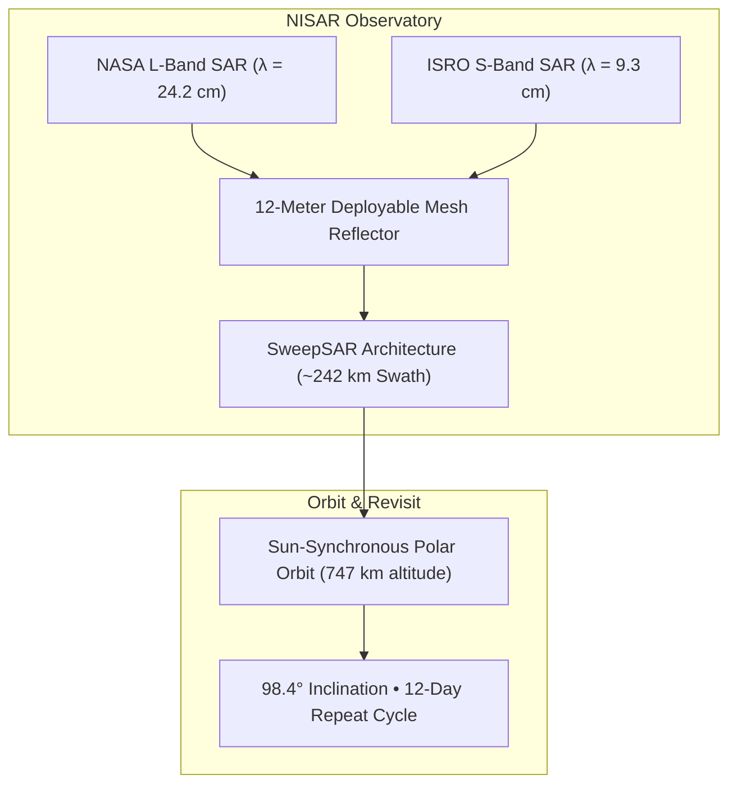
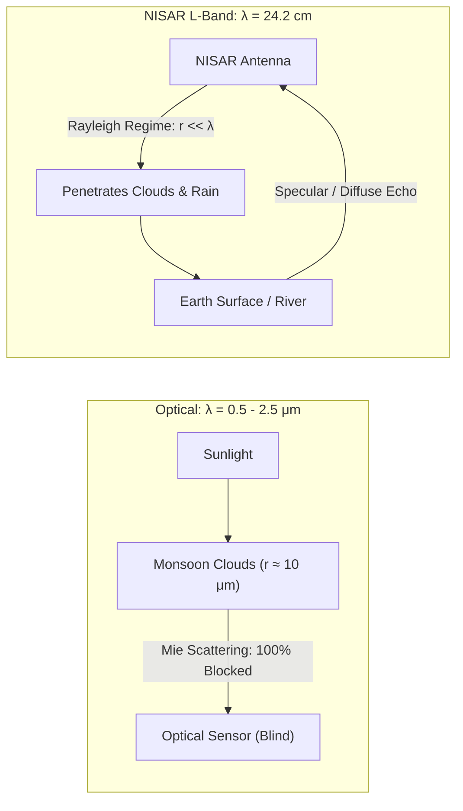
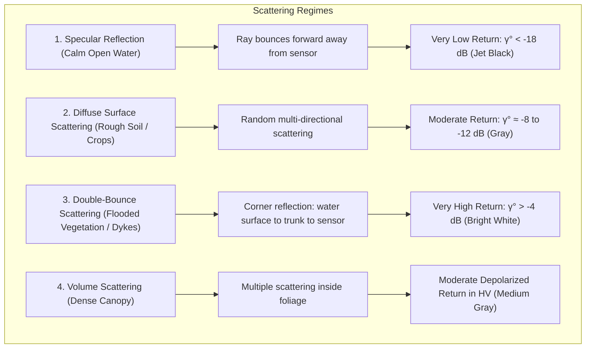

# Brahmaputra FloodWatch — Scientific Research & Radar Fundamentals

**Project:** Dancing with the SARs: Brahmaputra FloodWatch  
**Challenge:** NASA Space Apps Challenge 2026 — Earth Science  

---

## 1. NASA-ISRO Synthetic Aperture Radar (NISAR) Mission Background

The **NASA-ISRO Synthetic Aperture Radar (NISAR)** observatory represents an unprecedented partnership between the National Aeronautics and Space Administration (NASA) and the Indian Space Research Organisation (ISRO). NISAR is the first satellite mission to deploy dual-frequency Synthetic Aperture Radar using both **L-band** (24.2 cm wavelength / 1.25 GHz, provided by NASA Jet Propulsion Laboratory) and **S-band** (9.3 cm wavelength / 3.2 GHz, provided by ISRO Space Applications Centre).

### 1.1 Mission Specifications & Orbit Geometry
- **Orbit Type:** Sun-synchronous, dawn-dusk low Earth orbit at an altitude of approximately 747 km.
- **Orbital Repeat Cycle:** 12-day exact repeat cycle (173 orbits per cycle).
- **Antenna Architecture:** 12-meter deployable mesh reflector utilizing NASA's innovative **SweepSAR** technique on receive, combining wide spatial coverage (~242 km swath) with fine azimuth resolution (~3 to 10 m).
- **Primary Science Objectives:** Quantify global land surface deformation (tectonics, volcanism, subsidence), ice-sheet and glacier velocities, forest carbon biomass, and surface hydrological dynamics including wetland inundation and extreme flood events.

---

## 2. SAR Remote Sensing Fundamentals in Accessible Language

### 2.1 Why Optical Satellites Fail in the Brahmaputra Valley
Optical sensors (e.g., Landsat-8/9, Sentinel-2, MODIS) rely on reflected sunlight within the visible and near-infrared spectrum ($\lambda \approx 0.4 - 2.5\,\mu\text{m}$). During the South Asian monsoon, atmospheric water droplets and cloud decks (droplet radii $r \approx 5 - 20\,\mu\text{m}$) cause intense Mie scattering ($r \approx \lambda$). The optical sensor detects only diffuse solar reflection from cloud tops, completely obscuring the Earth's surface beneath.

### 2.2 Why Radar Pulses Penetrate Clouds and Heavy Rain
Synthetic Aperture Radar is an **active microwave sensor**:
1. **Self-Illuminating:** It emits its own electromagnetic pulses and records the amplitude and phase of the backscattered signal, operating independently of solar illumination (24/7 day and night capability).
2. **Rayleigh Scattering Regime:** Because microwave wavelengths (NISAR L-band: $\lambda = 24.2\text{ cm} = 242,000\,\mu\text{m}$) are orders of magnitude larger than rain and cloud droplet radii ($r \ll \lambda$), atmospheric scattering is governed by the Rayleigh regime where scattering cross-section attenuates with $\lambda^{-4}$. Cloud and rain attenuation at L-band is virtually negligible ($\approx 0.01 - 0.05\text{ dB/km}$ even in tropical downpours).

### 2.3 Wave-Surface Interaction Mechanisms

When microwave energy reaches the Earth's surface, the backscattered return ($\sigma^0$ or $\gamma^0$) is determined by surface roughness, dielectric permittivity, and geometry:

1. **Specular Reflection (Open Water):** Calm standing water behaves like a smooth electromagnetic mirror. Because surface roughness is much smaller than the radar wavelength (Rayleigh roughness criterion $h < \frac{\lambda}{8 \cos\theta}$), incident radar waves reflect forward away from the satellite. Almost zero energy returns to the receiving antenna, creating a very low backscatter coefficient (typically $-18.0\text{ dB}$ to $-25.0\text{ dB}$), appearing jet black in SAR imagery.
2. **Diffuse Surface Scattering (Rough Dry Land):** Agricultural soils, unflooded alluvial sandbars, and short vegetation have surface irregularities comparable to $\lambda$. Radar energy is scattered isotropically in multiple directions, with a significant fraction returning to the antenna (mean backscatter $-8.0\text{ dB}$ to $-12.0\text{ dB}$), appearing medium gray.
3. **Double-Bounce Scattering (Flooded Trees / Emergent Vegetation):** When standing water inundates vegetation or structures with vertical elements (tree trunks, reed beds, bridge piers, or masonry dykes), the wave reflects from the horizontal water surface onto the vertical obstacle and rebounds directly back to the sensor. This "corner reflector" effect produces anomalously bright signatures ($-4.0\text{ dB}$ to $+3.0\text{ dB}$), which can be exploited to detect floodwaters under tree canopies.

---

## 3. NISAR Level-2 GCOV Data Architecture

### 3.1 Product Definition & JPL Specification (JPL D-102274)
The **GCOV (Geocoded Polarimetric Covariance)** product is a standard NISAR Level-2 science product generated by the NISAR Science Data System (SDS). Derived from Level-1 Range-Doppler Single Look Complex (RSLC) granules, GCOV contains:
- **Radiometric Terrain Correction (RTC):** Converts radar brightness $\beta^0$ (radar coordinate frame) into terrain-normalized gamma naught ($\gamma^0$), using an external Digital Elevation Model (Copernicus 30m Global DEM). RTC normalizes for local illuminated area variations caused by hills and river valley slopes, ensuring that backscatter variations represent true physical surface changes rather than topographic tilt.
- **Hermitian Covariance Matrix Elements:** For dual-pol (HH/HV) modes, the upper-triangular elements of the $2 \times 2$ covariance matrix are multi-looked and stored:
  $$\mathbf{C}_2 = \begin{bmatrix} \langle |S_{HH}|^2 \rangle & \langle S_{HH} S_{HV}^* \rangle \\ \langle S_{HV} S_{HH}^* \rangle & \langle |S_{HV}|^2 \rangle \end{bmatrix}$$
  where the diagonal elements represent co-polarized ($\text{HHHH}$) and cross-polarized ($\text{HVHV}$) backscatter powers.
- **Cartographic Map Grid:** Level-2 GCOV rasters are natively projected onto standard Universal Transverse Mercator (UTM) grids with constant easting/northing pixel spacing. For the Brahmaputra Valley, data are delivered in **WGS 84 / UTM Zone 46N (`EPSG:32646`)**.

### 3.2 Single-Polarization HHHH Backscatter Physics
In our operational processing pipeline, water classification relies on **single-polarization Horizontal-Transmit Horizontal-Receive (HHHH)** backscatter ($\gamma^0_{HH} = \langle |S_{HH}|^2 \rangle$).

**Why HHHH is preferred for open-water mapping:**
- At intermediate satellite incidence angles ($\theta \approx 30^\circ - 45^\circ$), horizontal polarization ($HH$) yields lower specular backscatter over smooth calm water than vertical polarization ($VV$) due to Fresnel reflection coefficients:
  $$R_{HH} = \frac{\cos\theta - \sqrt{\epsilon_r - \sin^2\theta}}{\cos\theta + \sqrt{\epsilon_r - \sin^2\theta}}$$
  This produces a higher radiometric contrast ($\Delta\gamma^0 \approx 9 - 13\text{ dB}$) between water and adjacent land surfaces compared to $VV$.

---

## 4. What Single-Polarization HHHH Can and Cannot Establish

To maintain scientific integrity, the physical capabilities and explicit limitations of single-polarization HHHH radar water classification must be clearly documented:

| Capability: What HHHH Backscatter CAN Reveal | Limitation: What HHHH Backscatter CANNOT Establish |
| :--- | :--- |
| **Open Surface Water Extent:** Delineates continuous open water surfaces with high radiometric contrast (mean backscatter -18.63 dB vs. -8.91 dB for dry land). | **Water Depth ($m$):** Radar backscatter measures only surface roughness and dielectric reflection at the air-water boundary; it does not measure water column depth or river bathymetry. |
| **Flood Expansion Over Dry Land:** Sharp drop in backscatter ($\Delta\gamma^0 < -4.50\text{ dB}$) reliably detects newly submerged dry soils and vegetation. | **Volumetric Discharge ($m^3/s$):** Backscatter cannot determine river flow velocity or discharge without hydraulic modeling and gauge cross-sections. |
| **Braided Channel Boundary Tracing:** Identifies complex river networks and isolated char boundaries through cloud cover at 10-meter spatial resolution. | **Submerged Vegetation with Canopy Cover:** If vegetation emerges above floodwater, double-bounce elevates backscatter, causing open-water thresholding to omit flooded forest/canopy areas. |
| **Temporal Stability:** Repeat-pass acquisitions with matched geometry enable direct pixel-level subtraction without geometric look-angle distortions. | **Wind-Roughened Open Water:** Strong surface winds generate capillary-gravity waves matching the radar Bragg resonance wavelength ($\Lambda_B = \frac{\lambda}{2\sin\theta}$), increasing backscatter and causing false-negative omissions. |
| **Independent Verification of Optical Cloud Blanks:** Verifies land/water distribution when optical satellites produce 100% nodata. | **Smooth Dry Surfaces (Tarmac / Bare Sand):** Exceptionally smooth, dry sandbars or airport runways can exhibit low specular backscatter, potentially causing false-positive water classifications without multi-temporal baseline subtraction. |

---

## 5. Authoritative References & Mission Citations

1. **NASA/JPL NISAR Mission:** Rosen, P. A., et al. (2017). *The NASA-ISRO SAR (NISAR) Mission: Science and Applications Overview*. IEEE Aerospace Conference. [doi:10.1109/AERO.2017.7943714](https://doi.org/10.1109/AERO.2017.7943714).
2. **JPL Product Specification:** Jet Propulsion Laboratory (2024). *NISAR Science Data System Level-2 Geocoded Polarimetric Covariance (GCOV) Product Specification*. JPL Document D-102274, California Institute of Technology. [https://nisar.jpl.nasa.gov](https://nisar.jpl.nasa.gov).
3. **ASF DAAC NISAR Archive:** Alaska Satellite Facility (ASF) Distributed Active Archive Center (DAAC). *NISAR Data Management & Product Distribution Guidelines*. NASA Earth Science Data and Information System (ESDIS). [https://asf.alaska.edu](https://asf.alaska.edu).
4. **ISRO Bhoonidhi Portal:** Indian Space Research Organisation, National Remote Sensing Centre (NRSC). *Bhoonidhi Open Data Dissemination User Guide & STAC API Specification*. [https://bhoonidhi.nrsc.gov.in](https://bhoonidhi.nrsc.gov.in).
5. **SAR Surface Hydrology & Flood Delineation:** Martinis, S., Twele, A., & Voigt, S. (2015). *Towards operational near real-time flood detection using a split-based automatic thresholding procedure on high resolution TerraSAR-X data*. Natural Hazards and Earth System Sciences, 15(4), 803–814.
6. **Brahmaputra Morphodynamics:** Sarma, J. N. (2005). *Fluvial process and morphology of the Brahmaputra River in Assam, India*. Geomorphology, 70(3-4), 226–256.

